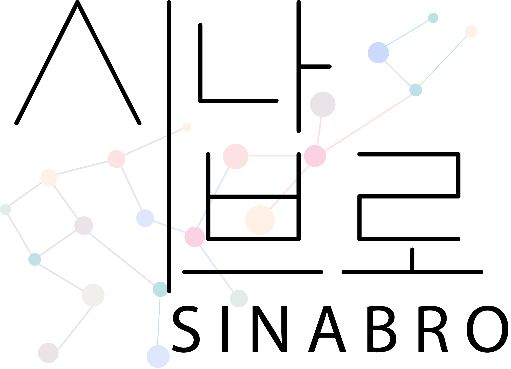

# Sinabro



**Sequential mutation simulation for coding-sequence robustness.**

Sinabro applies one single-base substitution at a time, evaluates the resulting protein, and records the mutation trajectory. Mutation models include random substitutions, sequence motifs, and COSMIC SBS signatures.

This repository is the package accompanying *Human and bats genome robustness under COSMIC mutational signatures*. Version **3.0.0** provides a single `sinabro` package with explicit coordinates, reproducible random streams, and automated tests. It is a refactored implementation for further research and manuscript revision; the preserved historical source remains the reference for earlier calculations. See [reproducibility and version provenance](docs/reproducibility.md) before replacing a historical analysis.

## Install

Python 3.9 or later, NumPy, and Biopython are required. From this checkout:

```bash
python -m pip install .
```

For development, use `python -m pip install -e ".[analysis]"`. The optional `analysis` extra supplies SciPy for the pairwise dN/dS functionality.

For conda, the included environment uses the recorded Python 3.9.15 / NumPy 1.21.6 / Biopython 1.79 versions:

```bash
conda env create -f environment.yml
conda activate sinabro
python -m pip install --no-build-isolation -e ".[analysis]"
```

The environment specification records dependencies; it does not by itself reproduce manuscript results.

## Quick start

```python
import sinabro as snbr

# CDS-plus: one context nucleotide on each side of the coding sequence.
sequence = "TATGCTGACTCGGTCATCGATCGGTTCTCATTGAT"
trajectory = snbr.Trajectory("example", sequence, seed=42)
trajectory.autofill(
    condition="nonsynonymous",
    method="signature",
    mutational_signature="SBS2",
)
print(trajectory.accepted_steps)
trajectory.show()
```

The default criterion stops at the first protein-sequence change. For complete trajectories, `accepted_steps` excludes that final event, and its mean is the original RUMS measure. The default coding slice is `sequence[1:-1]`; plain CDS inputs require explicit coordinates.

BLOSUM evaluation can tolerate protein changes below an explicit threshold:

```python
trajectory = snbr.Trajectory("example", sequence, seed=42)
trajectory.autofill(
    condition="evaluation", method="signature",
    mutational_signature="SBS2", measure="blosum", threshold=20,
)
```

BLOSUM results are criterion-neutral stopping times. They need separate labels from synonymous RUMS and do not establish functional neutrality experimentally.

## Run from the command line

```bash
sinabro --input examples/cdsplus.fa --output results/identity.csv \
  --signatures SBS2 SBS13 --n-trajectories 100 --seed 42
python examples/compare_criteria.py
```

The CLI writes trajectory data and a manifest containing input hashes, settings, dependency versions, and completion counts. The included FASTA is synthetic demonstration data.

## Repository guide

| Path | Purpose |
|---|---|
| `sinabro/` | Installable package: mutation engine, evaluation policies, metrics |
| `sinabro/data/` | Packaged COSMIC v3.3.1 SBS tables |
| `examples/` | Small executable examples and synthetic input |
| `tests/` | Automated package tests |
| `docs/` | API, scientific model, and reproducibility records |
| `environment.yml` | Conda environment using the recorded dependency versions |

Read the [API guide](docs/api.md), [algorithm](docs/algorithm.md), [testing guide](docs/testing.md), and [change log](CHANGELOG.md). Historical import changes are documented in [migration notes](docs/migration.md).

## Test

```bash
python -m pip install -e ".[analysis]"
python -m unittest discover -s tests -v
```

The suite covers all 64 codons and their nine possible substitutions, mutation probabilities, boundaries, stopping rules, metrics, serial/parallel reproducibility, and the CLI. GitHub Actions runs package checks on Linux and Windows.

## Manuscript analysis and license

The separate [manuscript analysis repository](https://github.com/StudyingAnt/Simple_robustness_analysis_of_cds) contains preprocessing and biological analyses. Package tests and synthetic examples are distinct from reproducing the human/bat figures.

BSD-3-Clause. Copyright Joon-Hyun Song. See [LICENSE](LICENSE).
